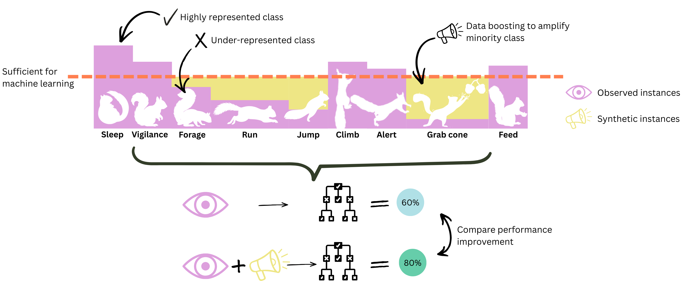

## Making the Best of a Bad Dataset: Synthetic Solutions for the Cryptic, Rare, and the Dangerous

Machine learning enables automated classification of behaviour from animal-borne accelerometer datasets. These methods are, however, dependent on large training datasets representing each of the classes of interest. In wildlife research rare, cryptic, or logistically challenging species/behaviours tend to yield limited observations, restricting the use of these data-intensive classification approaches and often leaving small datasets and minority classes within the larger datasets, unusable. To overcome this limitation and boost the usability of small datasets, we evaluate a suite of data augmentation and synthetic sample generation strategies for increasing minority-class representation in accelerometer data.

### Data
The included data was pre-formatted from the original data sourced from online repos into standardised format in alternate github repository: [https://github.com/OakAlice/DataReformatting](https://github.com/OakAlice/DataReformatting).

### Workflow
To be filled in later...